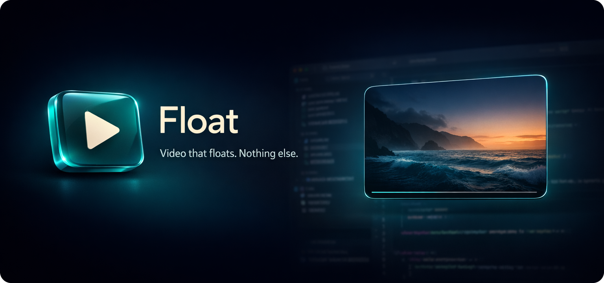

<div align="center">
  <a href="https://float.video">
    
  </a>

  <br /><br />

  <p>
    A chromeless, always-on-top macOS video browser built with Exact, AppKit, and <code>WKWebView</code>.<br />
    Automatically pins any site's video player edge-to-edge — zero tabs, zero sidebars, zero Electron bloat.
  </p>

  <p>
    <a href="https://github.com/noisyneighborstudio/float/releases/latest">
      
    </a>
    
    
    <a href="https://raw.githubusercontent.com/noisyneighborstudio/float/appcasts/appcast.xml">
      
    </a>
  </p>

  <p>
    <strong><a href="https://float.video">Download at float.video</a></strong>
    &nbsp;·&nbsp;
    <a href="https://github.com/noisyneighborstudio/float/releases/latest">GitHub Releases</a>
    &nbsp;·&nbsp;
    <a href="#features">Features</a>
    &nbsp;·&nbsp;
    <a href="#keyboard-shortcuts">Shortcuts</a>
    &nbsp;·&nbsp;
    <a href="#building-from-source">Build from Source</a>
  </p>

  <sub>Mirrors: <a href="https://floattv.app">floattv.app</a> · <a href="https://floatv.app">floatv.app</a></sub>
</div>

<br />

---

## Why Float?

Built-in Picture-in-Picture breaks custom subtitles, strips away quality selectors and player controls, and gets blocked by streaming sites. **Float** is a real Safari-class `WKWebView` window distilled down to pure glass — giving you hardware-accelerated video decoding, FairPlay DRM (Netflix, Apple TV+, Prime Video), AirPlay, and full native site controls inside a lightweight floating window that follows you across every macOS Space and over full-screen apps.

---

## Features

### Edge-to-Edge Video Fill (`⇧⌘F`)
On by default. Float detects the main playing `<video>` on any page and pins its player container — keeping native captions, scrubbers, quality menus, and site controls intact — while hiding navigation bars, sidebars, and comments. Works site-agnostically across **YouTube**, **Netflix (DRM)**, **Twitch**, **Prime Video**, **Apple TV+**, **Plex**, **Vimeo**, and any HTML5 player.

### Native Liquid Glass UI
Both the Home window and the floating `?` Keyboard Shortcuts HUD use native macOS 26 **Liquid Glass** (`NSGlassEffectView`), falling back seamlessly to a translucent `.hudWindow` backdrop (`NSVisualEffectView`) on earlier macOS versions.

### Smart Home Mosaic & One-Click Resume (`⇧⌘H` / `⇧⌘R`)
Float automatically builds a clean tile mosaic from the video sites you actually watch (hover any tile to remove it). A glowing **Resume** card remembers your last video's title (pulled from player overlays, Media Session, or page metadata) and exact timestamp with a live progress bar — automatically skipping trailers, previews, and ads under 3 minutes.

### Global Quick Fade (Hold `Right ⌘`)
Peek right through Float from **any** app without losing your spot. Holding `Right ⌘` smoothly fades the window to your configured opacity (default `50%`) and restores it on release, respecting macOS Reduce Motion. Customize everything in **Float › Settings…** (`⌘,`):
- **Trigger:** Hold `Right ⌘`, Hold `Right ⌥`, a **Custom Hotkey** (Hold or Toggle mode — requires zero Input Monitoring permission), or Off
- **Opacity:** Quick presets (`15%`, `25%`, `50%`, `75%`) plus a 5%-step continuous slider (`15%`–`95%`)

### Chromeless Window, Click-Through & 6-Zone Docking
- **Top-Edge Drag Strip:** An invisible 18px strip along the top edge fades in on hover — drag anywhere on it to move Float, or **double-click** to snap and lock the window to the video's exact natural aspect ratio (`⇧⌘A`).
- **Temporary Expand (`⇧⌘E`):** Temporarily enlarge and center Float for comfortable catalog browsing, then press `⇧⌘E` again (or dock with `⌃⌘1`–`⌃⌘6`) to restore your exact previous window size and position.
- **Click-Through Ghost Mode (`⇧⌘K`):** Let clicks pass straight through the video to your editor or terminal underneath (automatically caps opacity at `60%` so you can see both).
- **Animated Opacity (`⌘-` / `⌘=`):** Smoothly step opacity between `15%` and `100%`.
- **Magnetic 6-Zone Docking (`⌃⌘1`–`⌃⌘6`):** Snap cleanly to Top Left / Center / Right or Bottom Left / Center / Right with a 12px screen margin.
- **Global Boss Key (`⌃⌥⌘F`):** Instantly hide or restore Float from any app (customizable via **Float › Settings…** or **Float › Show/Hide Hotkey…**).
- **Fast URL & Search Bar (`⌘L`, `⇧⌘V`):** Enter a full URL, a bare domain (`netflix.com`), or plain keywords to search YouTube directly — or open a copied URL straight from your clipboard.

---

## Install

1. Download the latest signed & Apple-notarized release from **[float.video](https://float.video)** (or [GitHub Releases](https://github.com/noisyneighborstudio/float/releases/latest)).
2. Unzip and drag **`Float.app`** into `/Applications`.
3. Launch Float, press <kbd>⌘</kbd><kbd>L</kbd>, and paste any video link or type a YouTube search.

Release builds automatically stay up to date via **Sparkle** (**Float › Check for Updates…**).

---

## Keyboard Shortcuts

> [!TIP]
> Press <kbd>?</kbd> anywhere inside Float (outside text inputs) to open the floating **Liquid Glass Keyboard Shortcuts HUD**, which dynamically reflects your customized Quick Fade and Show/Hide hotkeys.

### Navigation & Playback

| Shortcut | Action |
| :--- | :--- |
| <kbd>⌘</kbd><kbd>L</kbd> | Open URL or search YouTube |
| <kbd>⇧</kbd><kbd>⌘</kbd><kbd>V</kbd> | Open URL from clipboard |
| <kbd>⇧</kbd><kbd>⌘</kbd><kbd>H</kbd> | Home mosaic |
| <kbd>⇧</kbd><kbd>⌘</kbd><kbd>R</kbd> | Resume last video at saved timestamp |
| <kbd>⌃</kbd><kbd>Space</kbd> | Play / Pause active video |
| <kbd>⌘</kbd><kbd>R</kbd> | Reload page |
| <kbd>⌘</kbd><kbd>[</kbd> / <kbd>⌘</kbd><kbd>]</kbd> | Back / Forward |

### Video & Window

| Shortcut | Action |
| :--- | :--- |
| <kbd>⇧</kbd><kbd>⌘</kbd><kbd>F</kbd> | Toggle Video Fill (edge-to-edge player) |
| <kbd>⇧</kbd><kbd>⌘</kbd><kbd>E</kbd> | Expand / restore window for browsing |
| <kbd>⇧</kbd><kbd>⌘</kbd><kbd>A</kbd> | Lock / unlock window to video aspect ratio |
| Double-click top strip | Snap & toggle video aspect lock |
| <kbd>⌘</kbd><kbd>T</kbd> | Toggle Always on Top |
| <kbd>⇧</kbd><kbd>⌘</kbd><kbd>K</kbd> | Toggle Click-Through mode |
| <kbd>⌘</kbd><kbd>-</kbd> / <kbd>⌘</kbd><kbd>=</kbd> | Decrease / increase opacity (animated) |

### Position, Global & App

| Shortcut | Action |
| :--- | :--- |
| <kbd>⌃</kbd><kbd>⌘</kbd><kbd>1</kbd> – <kbd>3</kbd> | Dock Top Left / Top Center / Top Right |
| <kbd>⌃</kbd><kbd>⌘</kbd><kbd>4</kbd> – <kbd>6</kbd> | Dock Bottom Left / Bottom Center / Bottom Right |
| Hold <kbd>Right ⌘</kbd> *(global)* | Quick Fade overlay to configured opacity (default 50%) |
| <kbd>⌃</kbd><kbd>⌥</kbd><kbd>⌘</kbd><kbd>F</kbd> *(global)* | Show / Hide Float from any app |
| <kbd>⌘</kbd><kbd>,</kbd> | Open Settings (Quick Fade & Show/Hide hotkeys) |
| <kbd>?</kbd> | Toggle floating Liquid Glass Keyboard Shortcuts HUD |

---

## Building from Source

Float is built on **Exact** with a native Swift/AppKit/`WKWebView` macOS module.

### Build & Install

```sh
./build.sh                                      # Build → build/Float.app
OUT=/Applications ./build.sh                    # Build and install to /Applications
./build.sh FloatDev                             # Separate dev app with isolated bundle ID & data
VERSION=1.2.3 BUILD=7 NOTARIZE=1 ./build.sh     # Signed, notarized release with Sparkle feed → dist/
```

### Exact Development & Contract Tests

```sh
bun exact.mjs mac --run         # Build and launch on macOS
bun exact.mjs test web          # Run Contract tests on web
bun exact.mjs test macos        # Run Contract tests on macOS
```

> [!NOTE]
> **Code signing, Sparkle & DRM:** `app.json` links Sparkle `2.10.1` via `host.macos.swiftPackages` and sets `SUFeedURL`/`SUPublicEDKey`/`SUEnableAutomaticChecks` via `host.macos.infoPlist`. `NOTARIZE=1 ./build.sh` delegates directly to `exact release` to embed Sparkle, sign inside-out with hardened runtime (`Developer ID Application: Seth Webster (P8ZBH5878Q)`), notarize, staple, and assess with Gatekeeper.

---

## Architecture

| Path | Role |
| :--- | :--- |
| [`app.contract`](app.contract) | Declarative Exact UI (Home mosaic, Resume card, URL bar, menu & shortcut bindings) |
| [`app.ts`](app.ts) | State/command bridge and web fallback storage |
| [`macos/modules/FloatModule.swift`](macos/modules/FloatModule.swift) | Native AppKit + `WKWebView` + Sparkle module (chromeless window, Liquid Glass backdrops, Video Fill script, isolated `WKContentWorld` playback tracking, Quick Fade, Carbon hotkeys, Settings & Shortcuts HUD, `SPUStandardUpdaterController`) |
| [`app.test.contract`](app.test.contract) | End-to-end Contract test suite (URL resolution, scheme hardening, toggles, Settings, HUD) |
| [`build.sh`](build.sh) | Thin wrapper over Exact macOS builds & `exact release` notarized packaging |
| [`site/`](site/) | Zero-build static landing page & interactive desktop demo hosted on Cloudflare Pages |
| [`scripts/`](scripts/) | Release preparation, Sparkle EdDSA signing/verification, appcast publishing & site version sync |
| [`docs/offline-playback.md`](docs/offline-playback.md) | Architectural feasibility study on offline playback and DRM constraints |

**Security & Privacy Defaults:**
- Strict `http:` / `https:` navigation policy (blocks `file://` and non-web schemes)
- Playback telemetry runs inside a dedicated `WKContentWorld` (`float-track`) isolated from page JavaScript
- Zero telemetry, zero accounts; site history and preferences live locally in `UserDefaults`

---

## Releases & Website

<details>
<summary><strong>Release Pipeline (semantic-release + Sparkle)</strong></summary>

<br />

Pushing conventional commits to `main` triggers [`.github/workflows/release.yml`](.github/workflows/release.yml) on a self-hosted ARM64 macOS runner via `semantic-release`:
- `fix:` → patch release · `feat:` → minor release · `feat!:` → major release (other commit types skip releasing).
- A release builds, signs, notarizes, and staples `Float.app`, uploads `Float-<version>.zip` to the GitHub Release, EdDSA-signs and verifies the archive, publishes `appcast.xml` on the `appcasts` branch, and syncs `site/index.html` + `site/latest.json` on `main` via [`scripts/update-site-version.mjs`](scripts/update-site-version.mjs).
- Installed release builds update automatically via **Sparkle** (**Float › Check for Updates…**).

**Configuration & Secrets:**
- Hosting, feed URL, and public EdDSA key: [`updates.env`](updates.env)
- Sparkle EdDSA key: login keychain account `float`
- Signing & notarization secrets reference: `~/Documents/macos-sign-notarize.md`

</details>

<details>
<summary><strong>Download Website (Cloudflare Pages)</strong></summary>

<br />

The landing page lives in [`site/`](site/) (zero-build static HTML + icons) and is hosted on Cloudflare Pages (`float-video`), connected directly to `noisyneighborstudio/float`:
- **Production domains:** [`float.video`](https://float.video), [`floattv.app`](https://floattv.app), [`floatv.app`](https://floatv.app) — auto-deployed on pushes to `main` touching `site/*`.
- **PR previews:** Automatic preview deployments on all branches.
- **Version syncing:** Every release commits updated baked-in download URLs, version labels, and archive size to [`site/index.html`](site/index.html) and [`site/latest.json`](site/latest.json) on `main` (pushed with `GITHUB_TOKEN`, so GitHub Actions does not re-trigger while Cloudflare Pages deploys automatically). The page also live-hydrates from `appcast.xml` on load, falling back to the GitHub Releases API.

</details>
